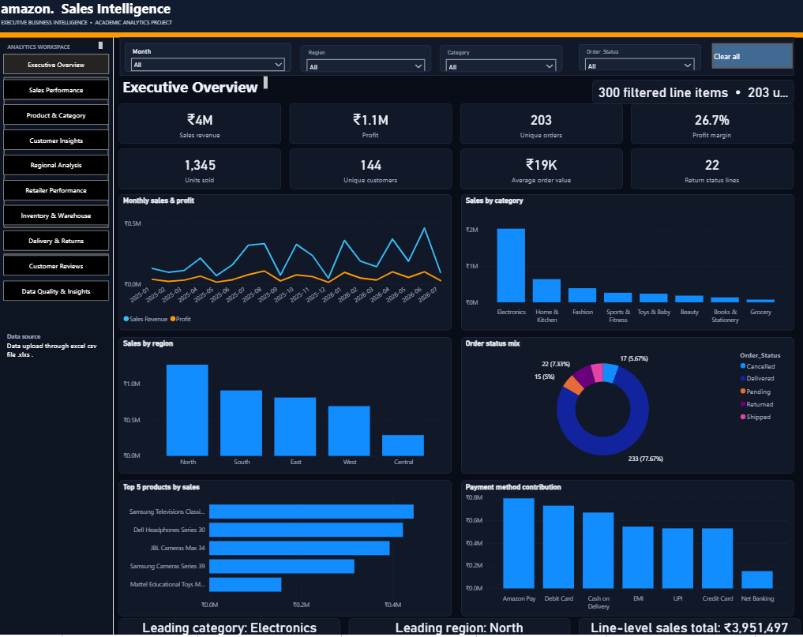
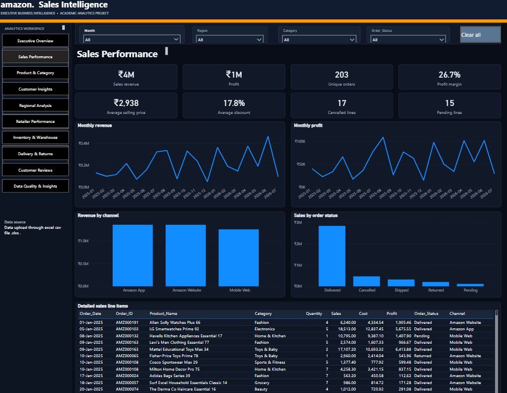
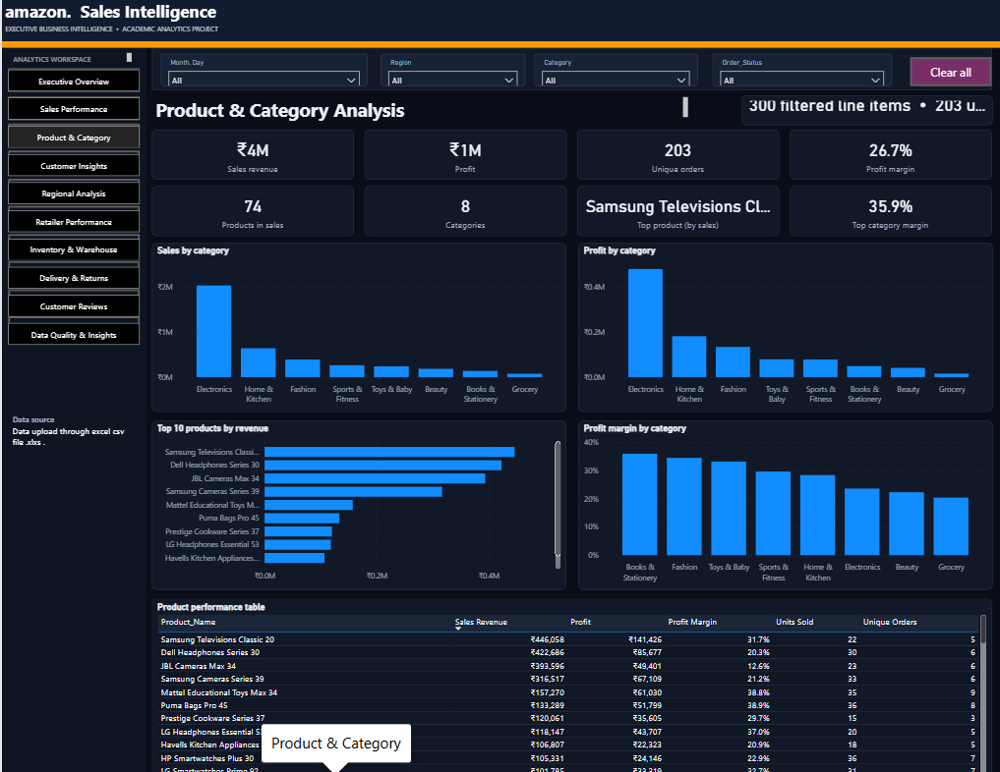
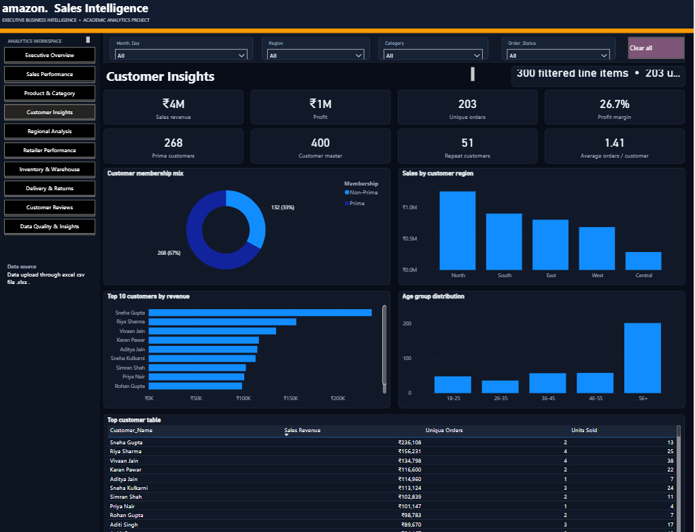
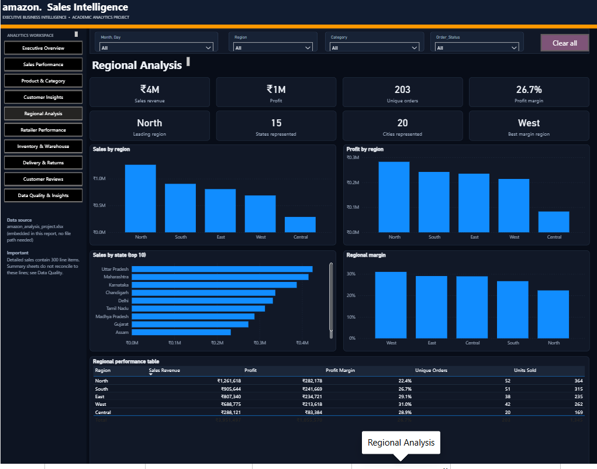
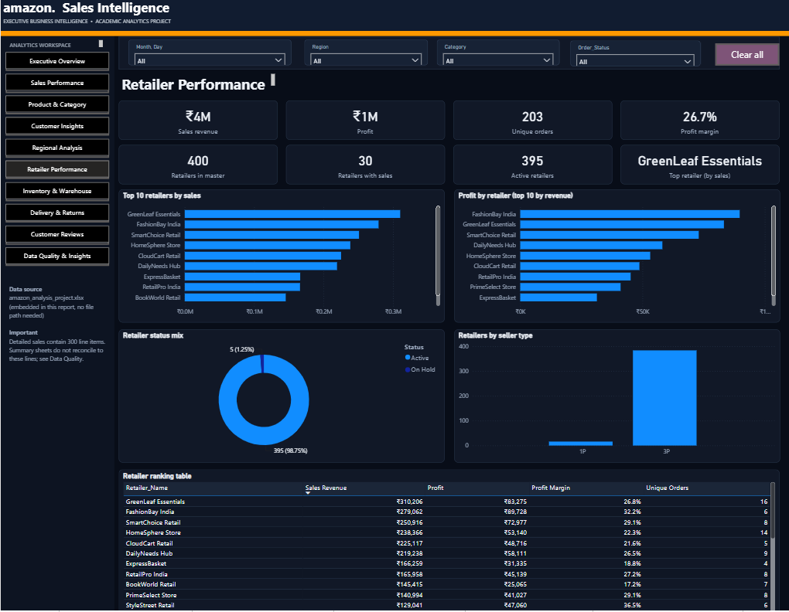
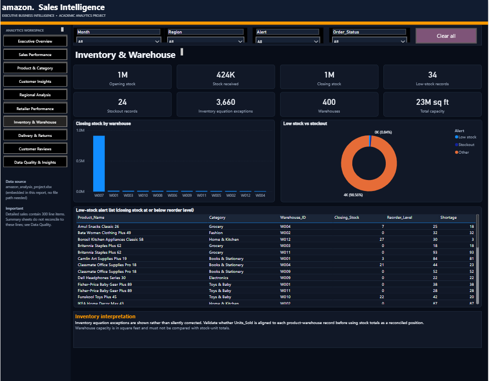
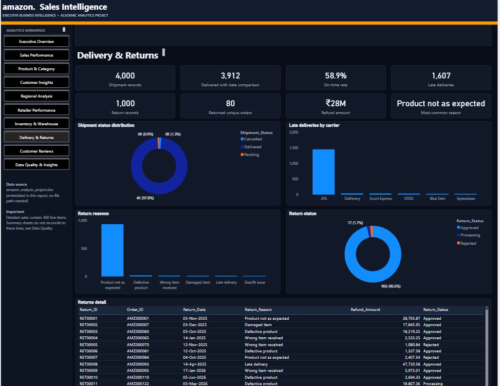
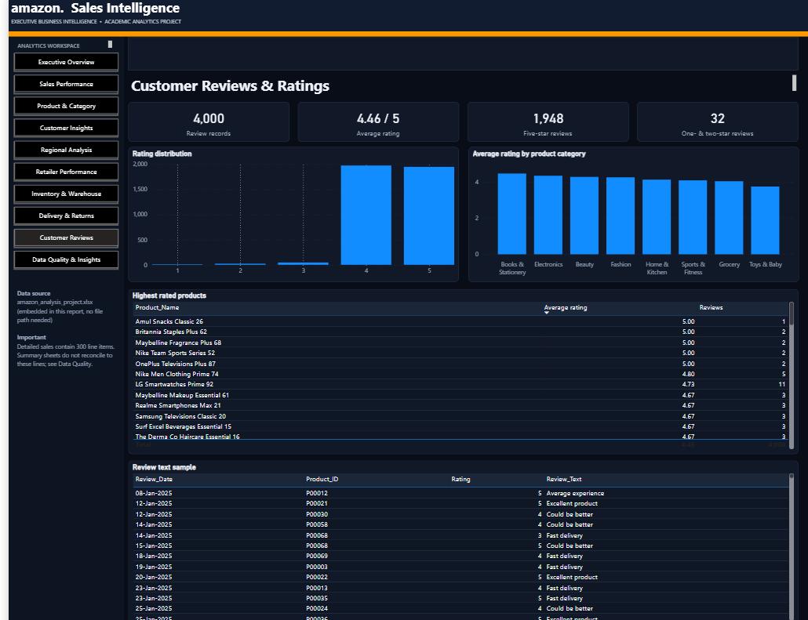
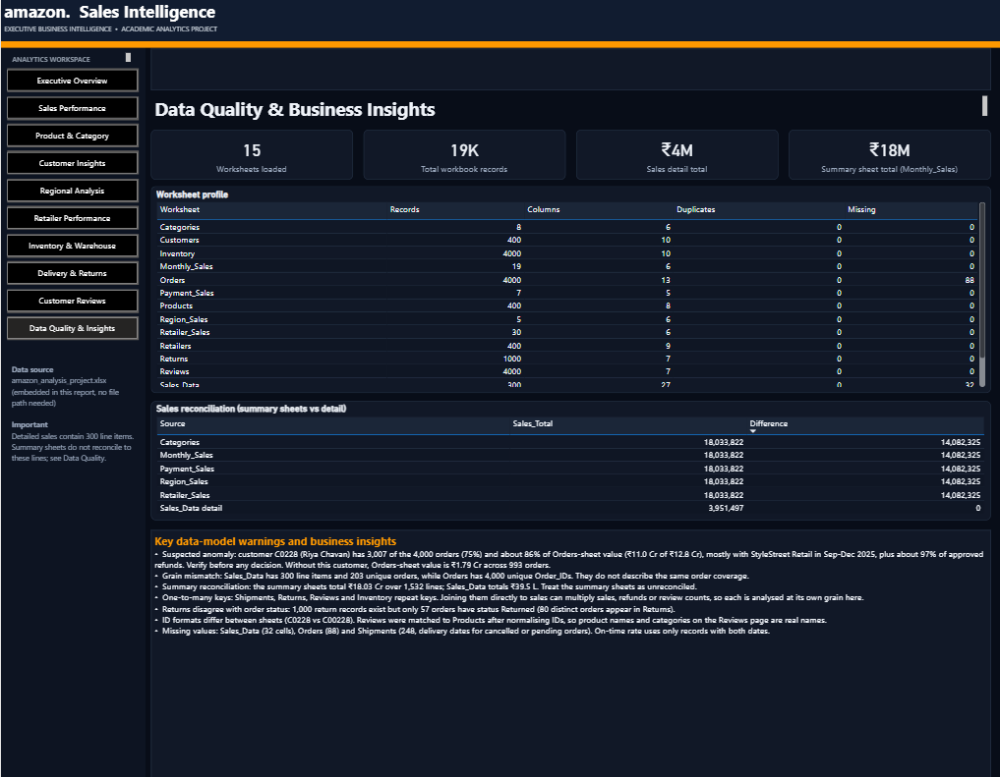

# Amazon Sales Intelligence

An end-to-end business intelligence portfolio project built around a multi-sheet retail sales workbook, MySQL analysis queries, and an interactive Power BI report.

> **Portfolio data note:** This repository documents the workbook supplied for this project. The files do not establish that the dataset is official Amazon internal data. Treat it as a portfolio / demonstration dataset unless its provenance is independently verified.

## Project overview

The project explores sales, profitability, products, customers, regions, retailers, inventory, shipments, returns, and customer reviews. The Power BI report contains 10 report pages with a dark executive dashboard design.

### Business questions

- How much revenue and profit are represented in the detailed sales table?
- Which product categories and regions contribute the most sales?
- How do monthly sales and profit change over time?
- Which products, customers, and retailers lead on sales?
- What do the inventory, shipment, return, and review tables indicate?
- Which data-quality and reconciliation checks should be reviewed before making operational decisions?

## Tools and technologies

- **Microsoft Excel** — multi-sheet source workbook
- **MySQL 8.0** — SQL analysis queries
- **Microsoft Power BI** — interactive report and embedded semantic model
- **Git / GitHub** — project versioning and portfolio presentation

A Python cleaning script was not included in the files supplied for this repository, so Python is not listed as an implemented project component.

## Repository structure

```text
Amazon-Sales-Intelligence/
├── README.md
├── .gitignore
├── Dashboard/
│   ├── AmazonSalesIntelligence.pbix
│   └── Screenshots/
│       ├── 01_Executive_Overview.png
│       ├── 02_Sales_Performance.png
│       ├── 03_Product_Category_Analysis.png
│       ├── 04_Customer_Insights.png
│       ├── 05_Regional_Analysis.png
│       ├── 06_Retailer_Performance.png
│       ├── 07_Inventory_Warehouse.png
│       ├── 08_Delivery_Returns.png
│       ├── 09_Customer_Reviews.png
│       └── 10_Data_Quality_Business_Insights.png
├── Dataset/
│   └── Amazon_Sales_Analysis.xlsx
├── SQL/
│   └── Amazon_Sales_Analysis_Queries.sql
└── Documentation/
    └── DATA_DICTIONARY.md
```

## Dataset overview

The Excel workbook contains 17 worksheet tabs. The principal tables include:

| Worksheet | Rows | Purpose |
|---|---:|---|
| Sales_Data | 300 | Line-item sales and profit detail |
| Orders | 4,000 | Order-level information |
| Products | 400 | Product master |
| Customers | 400 | Customer master and membership |
| Retailers | 400 | Retailer master |
| Warehouses | 400 | Warehouse master |
| Inventory | 4,000 | Product / warehouse stock records |
| Shipments | 4,000 | Shipment and delivery records |
| Returns | 1,000 | Return and refund records |
| Reviews | 4,000 | Product review records |
| Categories | 8 | Category summary |
| Monthly_Sales | 19 | Monthly summary |
| Region_Sales | 5 | Regional summary |
| Payment_Sales | 7 | Payment-mode summary |
| Retailer_Sales | 30 | Retailer summary |

The workbook also contains `Dashboard` and `Sheet2` tabs. Their presence is retained in the original workbook.

## Key metrics from `Sales_Data`

The following values are calculated directly from the 300-row `Sales_Data` worksheet, not from the larger supporting tables or dashboard labels.

| Metric | Calculated value |
|---|---:|
| Sales line items | 300 |
| Distinct orders | 203 |
| Units sold | 1,345 |
| Sales revenue | ₹3,951,497.30 |
| Profit | ₹1,055,569.63 |
| Profit margin | 26.71% |
| Missing delivery dates | 32 |

## Business insights

These are descriptive observations from the detailed sales table; they do not establish why a result occurred.

1. **Category contribution:** Electronics is the largest category by sales at ₹2,029,767.40, representing 51.4% of detailed sales revenue.
2. **Regional contribution:** North is the largest region by sales at ₹1,261,618.00.
3. **Regional profitability:** West has the highest calculated regional profit margin (31.0%) among the five regions.
4. **Monthly trend:** 2026-06 is the highest-sales month in the detailed sales table, with ₹463,146.90 in sales.
5. **Delivery-date completeness:** 32 of the 300 detailed sales rows have no `Delivery_Date`. These rows should be handled carefully in delivery-timing analysis.

## Power BI report pages

The supplied PBIX contains these 10 pages:

1. Executive Overview
2. Sales Performance
3. Product & Category
4. Customer Insights
5. Regional Analysis
6. Retailer Performance
7. Inventory & Warehouse
8. Delivery & Returns
9. Customer Reviews
10. Data Quality & Insights

### Dashboard screenshots

#### Executive Overview


#### Sales Performance


#### Product & Category Analysis


#### Customer Insights


#### Regional Analysis


#### Retailer Performance


#### Inventory & Warehouse


#### Delivery & Returns


#### Customer Reviews


#### Data Quality & Business Insights


## SQL analysis

`SQL/Amazon_Sales_Analysis_Queries.sql` contains 35 numbered query sections, including:

- Overall KPIs and monthly / yearly trends
- Category, sub-category, region, state, and city analysis
- Payment mode, order status, and sales channel analysis
- Top products, brands, and customers
- Customer membership and age-group analysis
- Retailer and warehouse performance
- Low-stock and inventory reconciliation checks
- Shipment delays and status
- Return reasons, refund amounts, and return rate
- Product ratings and category reviews
- Missing values, duplicate keys, unmatched orders, and order-value reconciliation

### Run the SQL file

1. Install / open MySQL 8.0 and MySQL Workbench.
2. Import the workbook sheets as tables, retaining the worksheet names used by the queries.
3. Open the SQL file in MySQL Workbench.
4. Review the `USE amazon_sales_analysis;` statement near the top and change it to your schema name if required.
5. Run the setup / table-check section first, then run analysis sections individually.

**Important:** The queries assume the relevant worksheet tables have been imported into MySQL. The workbook's tables have different grains (for example, sales line items, orders, shipments, inventory records, and reviews). Avoid joining raw one-to-many tables before aggregating, or totals can be multiplied. The SQL comments call out this risk.

## Open the Power BI report

1. Install Microsoft Power BI Desktop.
2. Open `Dashboard/AmazonSalesIntelligence.pbix`.
3. Explore the 10 report pages using the page navigation.
4. Use the available slicers and Clear all control where present.

The supplied README states that the data is embedded in the model. This repository contains the PBIX file; a separate PBIP project folder / standalone semantic-model source folder was not included in the upload.

## Data quality, interpretation, and limitations

- The detailed `Sales_Data` table has 300 rows and 27 columns; `Delivery_Date` is missing on 32 rows.
- Supporting tables have different row counts and business grains. Do not assume the 4,000-row `Orders`, `Shipments`, or `Reviews` tables represent the same population as the 300-row `Sales_Data` detail.
- The workbook includes summary sheets. Reconcile summary totals against detailed records before using them as a single source of truth.
- The returns table contains 1,000 records and repeated order IDs can occur. Aggregate returns at the correct grain before comparing with order counts or sales.
- The inventory sheet contains 3,660 rows where `Closing_Stock` differs from `Opening_Stock + Stock_Received - Units_Sold`. Treat these as reconciliation exceptions requiring investigation, not as silently corrected values.
- The 35 SQL queries are provided as analysis templates and assume table names match the workbook sheets. Review schema names and data types after import.
- Dashboard values may use model-specific filters, measures, or table grains. The KPI calculations above are explicitly based on `Sales_Data` in the supplied workbook.

## Skills demonstrated

- Business KPI definition and interpretation
- Excel workbook and multi-table data understanding
- SQL aggregations, joins, grouping, ranking, and data-quality checks
- Power BI dashboard navigation and visual analysis
- Revenue, profit, margin, product, customer, and regional analysis
- Data-grain awareness and reconciliation

## Author

**Om Chavhan**

*Data Analytics Portfolio Project — Amazon Sales Intelligence*

---

If you use or extend this project, document the dataset source, refresh steps, business definitions, and any transformations so the analysis remains reproducible.
